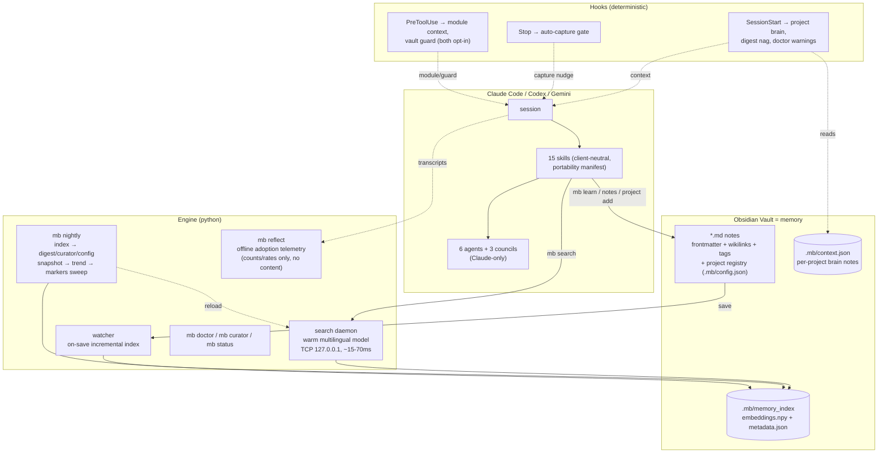

# 🧠 Singularity

**A personal AI memory system for Claude Code** — your assistant remembers everything, finds it in milliseconds, and gets smarter with every mistake.

Singularity turns an [Obsidian](https://obsidian.md) vault into a living, self-maintaining memory for your AI assistant: knowledge is **captured automatically**, **indexed on save**, **retrieved semantically** (Russian & English, ~15–70 ms), and **fed back into every new session** — while a set of disciplined skills, agents, and multi-agent councils keep the assistant's reasoning honest.

> Engine codename: **Singularity** · CLI: **`mb`** (memory brain) · Platforms: **Windows / macOS / Linux**

---

## Why?

Every AI coding session starts from zero. Decisions get re-litigated, solved bugs get re-debugged, and hard-won insights evaporate when the context window closes. Singularity closes that loop:

| Problem | Singularity's answer |
|---|---|
| "We already solved this last month…" | **Semantic search** over your whole vault: `mb search "how did we fix the reload bug"` → answer in ~20 ms |
| Insights die at the end of a session | **Auto-capture**: a Stop-hook blocks session end *once* and asks the assistant to persist what it learned |
| New session knows nothing | **Session recall**: a SessionStart-hook injects date, active tasks, pending plans, and health warnings into every session |
| The assistant repeats the same mistake | **Self-learning pipeline**: `report` → preventive rule embedded *at the exact execution point* → `LEARNED` |
| Notes rot, links break, knowledge silos | **Memory curator**: finds broken links, orphan notes, and *suggests* semantic wikilinks (never writes without approval) |
| Big decisions made on vibes | **Multi-agent councils**: adversarial investigator/critic/validator/historian rounds with falsification and calibrated confidence |

Everything lives in **plain Markdown inside your Obsidian vault** — no proprietary database, no cloud. You read and edit the same notes the assistant does; Obsidian's graph, backlinks, and Dataview dashboards work out of the box.

---

## Architecture at a glance



**Key design decisions** (reverse-engineered and battle-tested from a production system, then rebuilt cross-platform):

- **No vector database.** `sentence-transformers` + brute-force cosine over a `numpy` array. Up to ~1M chunks this is milliseconds — and infinitely debuggable.
- **Warm-model daemon.** The embedding model loads once (~10 s) and stays in RAM; every query after that is ~15–70 ms over local TCP. If the daemon dies, the client auto-restarts it — or falls back to a cold one-off search instead of failing.
- **Chunk = one `##` section.** Each chunk is embedded as `"{title} - {section}: {content}"`, so headers carry meaning. Wikilinks, tags, and aliases go into chunk metadata for filtered and graph-aware search.
- **Multilingual model** (`paraphrase-multilingual-MiniLM-L12-v2`): query in Russian, find notes written in English — and vice versa.
- **Token economy first.** Compact pipe-delimited output, 150-char excerpts, metadata trimming: a search result costs ~80 % fewer tokens than reading files, on every one of dozens of lookups per session.
- **Rules become hooks.** Critical discipline is enforced by deterministic code (hooks), not by hoping the model remembers an instruction.
- **Python core + thin platform layer.** All OS-specific code (Task Scheduler / launchd / systemd, process spawning, keyring) is isolated in `singularity/platform/`.

---

## Installation

### Prerequisites

- **Python ≥ 3.10** ([python.org](https://python.org), `winget install Python.Python.3.12`, `brew install python`, or your distro's package)
- **Git**
- **Obsidian** (recommended, not required — the engine works on any folder of Markdown)
- ~1.5 GB disk for the venv + model cache (CPU-only torch; no GPU needed)

### One command

```powershell
# Windows (PowerShell)
git clone <repo-url> D:\Singularity
cd D:\Singularity
.\install\install.ps1
```

```sh
# macOS / Linux
git clone <repo-url> ~/singularity
cd ~/singularity
./install/install.sh
```

The wrappers are ~20 lines each; all logic lives in `install/install.py`, which walks five phases:

1. **Python env** — creates `.venv`, installs dependencies, warms up the embedding model (~470 MB, cached locally — configurable off the system drive).
2. **Vault** — asks for your vault path, creates the memory folder tree (`learnings/`, `decisions/`, `howto/`, `incidents/`, `rules/`, `reference/`, `changelog/`, `templates/`, `_moc/`), binds it via `~/.singularity.json`.
3. **First index + daemon** — builds the semantic index over your vault, starts the warm daemon, runs an EN+RU smoke search.
4. **Client wiring** — registers the two hooks in `~/.claude/settings.json` (careful merge: your existing settings are backed up and preserved; every entry we own is marked `"_mb": true` for clean uninstall), then, **if they are installed**, wires OpenAI Codex and Google Gemini to the same memory (see [Other CLI clients](#other-cli-clients--codex--gemini)).
5. **Scheduler + verify** — registers the nightly index rebuild and the on-save watcher with your OS scheduler (Task Scheduler / launchd / systemd — all with missed-run catch-up), then finishes with `mb doctor`.

Re-running the installer is safe — it refreshes and re-verifies instead of breaking things. To remove everything (hooks, scheduled jobs, daemon) **without touching your vault**: `mb uninstall`. Already have Singularity installed? See [docs/UPGRADE.md](docs/UPGRADE.md) for exactly what changes on upgrade, and [docs/ROLLBACK.md](docs/ROLLBACK.md) to turn any specific new feature back off.

### Verify

```
mb doctor
```

You want a summary with `PASS` well into the double digits and no `FAIL` (real example from this repo's own dev machine: `PASS 19 | WARN 3` — the WARNs were "nightly job not yet migrated", "watcher not currently running", "vault guard disabled by default", all benign). Anything broken gets a status (`FAIL`/`WARN`/`AUTH`/`SKIP`), a reason, and a fix hint; `mb doctor --fix` repairs the light stuff, `--fix --heavy` reinstalls deps and rebuilds indexes.

### Other CLI clients — Codex & Gemini

Singularity is native to Claude Code, but the installer also wires **OpenAI Codex CLI** and **Google Gemini CLI** to the same memory — the same vault, `mb` CLI, SEM-FIRST rule, and skills. Each client is detected and configured **only if it is already installed**; Singularity never installs a third-party CLI for you. Exactly which skills go to which client is declared in one place, `install/skill_manifest.py` — every installer computes its list from it (so Claude/Codex/Gemini cannot drift apart into three independently-maintained lists), and every skill excluded from a client carries a recorded, human-readable reason (e.g. the three council skills stay Claude-only because they spawn Claude subagents via the Agent/Task tool that Codex/Gemini have no equivalent for — not a silent omission).

**Codex** gets a managed profile block in `~/.codex/AGENTS.md` (identity, vault path, `mb` CLI, SEM-FIRST, shortcuts — marker-delimited, your own text untouched) plus the portable skills junctioned into `~/.codex/skills/`. **Codex currently has no runtime hook and no `mb doctor` health check of its own** (unlike Gemini's `E*-gemini` block) — this is an honest, current limitation, not an oversight: verify a Codex install by checking `~/.codex/AGENTS.md` and `~/.codex/skills/` directly, or `mb hooks status --json` (which reports Codex as `supported: false` for the capture hook specifically, since Codex never receives one).

**Gemini prerequisites (you install these yourself):**

- **Node.js ≥ 20** and the official CLI: `npm install -g @google/gemini-cli@latest` (minimum tested **0.50.0**; hooks/skills need ≥ 0.26).
- **Auth** is Gemini's own — Google OAuth, `GEMINI_API_KEY`, or Vertex AI. Singularity never reads, copies, or stores your credentials.

**What the installer does for Gemini** (idempotent; re-running refreshes):

- A managed block in `~/.gemini/GEMINI.md` (engine + vault paths, SEM-FIRST, capture rule, shortcuts) — delimited by `SINGULARITY:BEGIN/END`; your own text outside it is never touched.
- The 12 portable skills (of 15 total — the three council skills stay Claude-only, see `install/skill_manifest.py`) junctioned into `~/.gemini/skills/`. Foreign skills you added are left alone.
- Two named hooks in `~/.gemini/settings.json` (backed up as `settings.json.bak-<ts>` before every change; foreign hooks/keys preserved): `singularity-session-start` injects the same live memory context Claude gets, and `singularity-after-agent` nudges you once per substantial session to capture insights — a passive `systemMessage`, so it never disturbs `--output-format json` automation.

An absent client is a clean skip; an old version keeps the profile but warns that skills/hooks may be ignored.

**Onboarding:**

```bash
gemini                        # start a session — SessionStart injects your memory context
/memory show                  # see the managed GEMINI.md block
/skills list                  # your Singularity skills, discovered and Enabled
mb search "what do we know about the daemon"   # SEM-FIRST works from inside Gemini
gemini -p "summarise the vault" --output-format json   # headless: clean JSON, hooks don't leak
```

**Good to know:** activating a skill may ask for one-time consent, and Gemini may prompt to trust the workspace — both are Gemini's own security, not something Singularity bypasses. The capture nudge is a reminder only (no retry, no extra model turn); opt out with `"auto_capture": false` in `<vault>/.mb/config.json`. Gemini's own experimental *Auto Memory* is separate and does not replace vault capture.

**Lifecycle:** re-run the installer (or `mb doctor --fix`) any time to refresh; `mb doctor` reports Gemini health under the `E*-gemini` checks; `mb uninstall` removes **only** Singularity-owned artifacts (the managed block, our two named hooks, and skill links that resolve back into the engine) — foreign content, credentials, Node, the Gemini CLI and your vault are untouched, and every settings mutation leaves a timestamped backup.

---

## Usage

A guided tour of every part of the system, grouped by topic, with real commands and real output — not just a flag reference. Jump to what you need:

[Search](#search-your-memory-the-command-youll-use-constantly) · [Capture](#capture-knowledge) · [Auto-indexing](#everything-indexes-itself) · [Projects](#multi-project-memory) · [Project brain & module context](#project-brain--module-context) · [Digest & nightly](#digest-and-nightly-orchestration) · [Curator](#curator-vault-health-and-semantic-lint) · [Vault guard](#vault-guard) · [Reflect](#adoption-telemetry-with-mb-reflect) · [Health & utilities](#health-stats-backup--config) · [Skills](#skills--say-the-trigger-word-in-any-session) · [Agents](#agents--spawned-for-heavy-lifting) · [Workflow](#the-solo-workflow-optional-but-recommended) · [Obsidian](#obsidian-side) · [Local LLM](#local-llm-backend)

### Search your memory (the command you'll use constantly)

```bash
mb search "how does the auto-capture hook decide to block"
mb search "почему выбрали TCP вместо unix socket"      # RU works too
mb search "reload bug" --top 10                        # more results
mb search "..." --type decision                        # learning|decision|howto|incident|rule|reference
mb search "..." --tags search,daemon                   # frontmatter + inline #tags
mb search "..." --links "Doctor_Plan"                  # only notes linked to [[Doctor_Plan]]
mb search "..." --path-prefix rules/                   # scope to a folder
mb search "..." --project myproj                       # scope to one project, a group, general, or personal
mb search "..." --json --full                          # machine-readable / untruncated
```

Output is compact by design: `file | score | [type] | title/section | excerpt`. Scores ≥ 0.5 are strong matches; below ~0.3 rephrase the query.

### Capture knowledge

```bash
mb learn "Watcher needs venv python on PATH — Task Scheduler runs with a minimal env" --task MY-TASK
mb learn "..." --task MY-TASK --head "Reload bug root cause"   # adds a semantic heading, not just a timestamp
mb learn "..." --task MY-TASK --project personal               # explicit personal-space routing
mb learn "..." --task MY-TASK --force                          # bypass dedup, always append
mb note new decision "Switch to TCP transport"     # creates a note from templates/
```

Worth recording: the non-obvious, the surprising, anything that took more than one attempt, and decisions (with **owner + source** — a decision nobody owns isn't a decision). Not worth recording: anything git already shows. Code goes in as `file:line`, never pasted. `mb learn` deduplicates against the last 10 sections of the target file automatically (exact match, prefix containment, or ~90% similarity) — a near-repeat insight is skipped with the matched heading printed, not silently re-appended, unless you pass `--force`.

**Mostly you won't do this by hand.** The assistant does it: skills auto-append phase notes to the active task's learnings doc, and the Stop-hook nudges once per substantial session if nothing was captured.

### Everything indexes itself

Save a note in Obsidian → the watcher re-indexes just that file and hot-reloads the daemon (~5–15 s) → it's searchable. A nightly full rebuild (with missed-run catch-up when the machine was off) is the safety net. Manual controls if you ever need them:

```bash
mb daemon start|stop|status|reload
mb index rebuild            # full
mb index update             # incremental (mtime+size diff)
mb index inspect <path>     # chunk-level view of one file in the current index
mb watch                    # run the watcher in the foreground
```

### Multi-project memory

One vault can serve several projects (or none) without their knowledge bleeding together. Register a project once — the assistant's `mb-onboard` skill does this for you conversationally, or run it yourself:

```bash
mb project add singularity D:/Singularity --group core --about "Personal AI memory engine"
mb project list
# singularity: D:/Singularity  group=core  about=Personal AI memory engine

mb project detect                        # resolve the current directory to a project
# singularity

mb project detect D:/Singularity/some/nested/dir --json
# {"cwd": "D:/Singularity/some/nested/dir", "project": "singularity"}
```

Detection is **deepest-path-wins**: the most specific registered path containing your cwd matches, so nested projects never get confused with their parent. Once a project is registered:

- `mb search "..." --project singularity` (or `--project core` for the whole group) scopes results to it; unscoped searches still see everything.
- `mb learn` / `mb note new` auto-detect the project from your current directory and stamp `project: singularity` into the note's frontmatter — you don't have to specify it by hand every time.
- A note with **no** `project:` frontmatter, or the literal value `general`, is treated as project-agnostic (`general`) — the common case for anything not tied to one codebase (this repo's own vault documentation, for example).
- **Personal space** is separate from projects and never reached by accident: only `--project personal` explicitly, or a note living under a path listed in `personal_roots` (`.mb/config.json`), is ever classified `personal`. Personal notes are never proposed by `mb digest`, never surfaced by `mb curator`'s suggestions, and never picked up by cwd-based auto-detection.

### Project brain & module context

Two SessionStart/PreToolUse mechanisms that hand the assistant exactly the context it needs, right when it needs it — both authored via `.mb/context.json` (hand-edited today, or via the `mb-onboard` skill for the brain-note part):

```jsonc
// .mb/context.json
{
  "singularity": {
    "brain_note": "reference/Singularity Brain.md",
    "context_map": {
      "hooks": {
        "globs": ["singularity/hooks", "install/register_hooks.py"],
        "note": "reference/Singularity Hooks Architecture.md"
      }
    }
  }
}
```

- **Project brain** — every SessionStart in a registered project's directory injects a budgeted excerpt (`brain_max_lines`, default 40) of `brain_note`, labeled `Project brain (singularity)` in the context. Keep it to what the assistant should know in *every* session of that project — key decisions, architecture, gotchas — not the whole design doc.
- **Module context** (opt-in — `module_context_enabled: true`) — before the assistant's first edit in a session to a path matching one of `context_map`'s `globs` (longest-prefix match, e.g. anything under `singularity/hooks/`), it gets a once-per-session excerpt of that module's own `note`. Good for "read this before touching this specific subsystem" rules that don't belong in the general project brain.

Both fail open silently (a missing/unreadable note just means no block that session, never a crash) and both respect the same path-traversal guard, so a malformed `context.json` entry can't leak a file from outside the vault.

### Digest and nightly orchestration

Learnings accumulate in `learnings/active/` all day; `mb digest` is how they turn into permanent, cross-referenced knowledge instead of just piling up.

```bash
mb digest plan
```
```
== mb digest plan -- index:ok sources:1 targets:1 ==

learnings/active/T.md / Some insight
   0.67  reference/Atomic.md  [reference]
```
(real output, this repo's own dev vault — a learning about "atomic file writes" correctly matched an existing "Atomic writes" reference note)

That's a **suggestion**, never an automatic merge: read the source section, fold it into the target note yourself (or have the assistant do it), then tell the journal it's handled so it never resurfaces:

```bash
mb digest mark learnings/active/T.md "Some insight"
mb digest mark --all              # mark every entry currently in the plan
mb digest plan --project myproj   # scope to one project's learnings
```

`mb nightly` is the automation behind this: scheduled once a day (`nightly_schedule_time`, default 03:00), or run by hand any time —

```bash
mb nightly
```
```
== mb nightly 2026-07-13T10:09:10 ==
  index: ok
  digest: ok
  curator: ok
  config: ok
  markers: ok
  trend: ok
```

— it updates the index, refreshes the digest/curator/config snapshots, appends one row to a trend history (so you can watch backlog size over time), and sweeps stale per-session marker files. If the index writer lock is held (the on-save watcher mid-update), the `index` step reports `skipped` rather than racing it — everything else still runs against the last committed generation. The next SessionStart after a nightly run with a real backlog shows the top 3 concrete actions (rate-limited to once per 72h, never a bare "you have pending work" nag):

```
digest backlog (3 actionable): learnings/active/T.md#Some insight -> reference/Atomic.md (0.67); ... — `mb digest plan` / `mb digest mark`
```

### Curator, vault health and semantic lint

```bash
mb curator
```

Three layers, all report-only — **curator never writes to your vault**, every finding needs your (or the assistant's) approval before anything changes:

1. **Mechanics** (free, no model): broken wikilinks, missing mandatory frontmatter, decisions without an owner/source, duplicate titles.
2. **Semantic suggestions**: notes that are topically related (cosine > 0.65 on whole-note embeddings) but have no wikilink between them yet — a candidate to link, not a duplicate.
3. **Semantic lint** (chunk-level, a stricter bar — cosine > 0.90): near-duplicate content, possibly split across two sections or two notes; supersession candidates (a much newer note saying nearly the same thing as a much older one, ≥60 days apart); and `.mb/context.json` issues — a `brain_note`/module note that's missing, or one that's grown past its line budget and is silently being truncated at runtime.

Real example (a seeded test vault, illustrating all three lint findings at once):

```
Duplicate sections (same file, cosine>0.9): 1
   0.96  reference/Atomic.md :: Main content  <->  Duplicate content
Duplicate sections (cross file, cosine>0.9): 0
Supersession candidates (gap>=60d): 0
Context budget/reference issues: 2
   [over_budget] demo-project: reference/BigBrain.md
   [missing_note] demo-project/core: reference/DoesNotExist.md
```

Here, `Atomic.md` really did have the same paragraph typed twice under different headings (a genuine duplicate, worth trimming); `BigBrain.md` is a registered project-brain note that's grown to 82 lines against a 40-line budget (still works, just silently truncated — worth shortening); and one module's context note points at a file that no longer exists (worth fixing or removing the mapping). `mb curator --json` gives you the same three layers as one machine-readable document.

### Vault guard

Opt-in (`vault_guard_enabled: true`) PreToolUse check that flags a new note or config edit landing somewhere unexpected — a safety net against "the assistant created a note in the wrong folder" or "edited `.mb/config.json` by hand instead of through `mb config set`." `vault_guard_mode: "audit"` (default once enabled) only warns; `"deny"` blocks the write outright. Start with `audit`, watch what it flags for a few sessions, and only switch to `deny` once you're confident it isn't flagging anything legitimate.

### Adoption telemetry with mb reflect

```bash
mb reflect --days 30
```
```
== mb reflect — last 30d, 43 top-level sessions (claude=40, gemini=3) ==
  by project: general=43
  search_then_read   17/43  (40%)
  vault_touch        18/43  (42%)
  code_edits         12/43  (28%)
  eligible_research  9/43  (21%)
  skill_invocation   19/43  (44%)
excluded: codex (no runtime hook / no discoverable transcript in this integration)
```
(real output — this repo's own dev machine, 43 actual Claude/Gemini sessions from the last 30 days)

Reading it: **43 top-level sessions** is the denominator every rate below is measured against — regardless of whether they touched Singularity at all, so a session that searched, read, and captured is never excluded from its own denominator. `search_then_read` (40%) — a search was followed by actually reading something, not fired and ignored. `vault_touch` (42%) — the vault was read or written at all. `code_edits` (28%) — a successful edit happened outside the vault. `eligible_research` (21%) — real search/read activity with **zero** code edits: pure investigation sessions, which a naive "did they edit code" metric would completely miss. `skill_invocation` (44%) — an engine-owned skill fired at least once.

Nothing here is a raw prompt, a tool argument, a session id, or a transcript path — only counts and rates, snapshotted to `.mb/reflect-last.json` and a 90-day trend history. See [Performance & privacy](#performance--privacy) below for how that's verified, not just claimed.

### Health, stats, backup & config

```bash
mb status
```
```
vault: D:\obsidian\memory brain
index: 2139 chunks, generation, age 1.9h, schema 3
daemon: up (pid 12345, orphan=False)
watcher: alive (heartbeat 4.2s ago)
scheduler[nightly]: registered=True
scheduler[watch]: registered=True
disk(.mb): 41.2 MB
capture hooks: enabled (source: explicit); installed: claude=yes, gemini=yes, codex=no
```
(real output — index/daemon/watcher/scheduler/disk/hooks in one snapshot; `mb status --json` adds `backlog` (digest actionable count) and `cache_age` (hours since each nightly snapshot last refreshed))

```bash
mb hooks status --json     # per-client desired/installed/effective capture-hook state
mb stats                   # notes/chunks/types/coverage from index metadata -- never note content
mb backup create           # checksummed config + index-pointer snapshot
mb backup list|verify <id>|restore <id>
mb config validate         # type/range checks + unknown-key warnings
mb config get <key>
mb config set <key> <value>   # validated, atomic write
```

### Skills — say the trigger word in any session

| Skill | Say… | What happens |
|---|---|---|
| `mb-search` | *sem, найди в памяти, what do we know about X* | Semantic search before any grep/file-reading |
| `mb-memory` | *um, запомни в vault* | Structured capture following the note contract (routes to learning/decision/howto/reference/**personal** via `--project personal`) |
| `mb-onboard` | *onboard this project, заведи проект в память* | Registers a project (`mb project add`), authors a starter brain note, wires it into `.mb/context.json` |
| `mb-triage` | *triage this, разберись с этой ошибкой* | Inverse Trust: `mb search` over incidents/rules **before** touching code; captures only a recurring root-cause class |
| `mb-llm-delegate` | *делегируй локалке, delegate to local model* | Offloads a generation/edit task to the local `mb llm` model while you orchestrate |
| `workflow-helper` | *fw, wh, next* | Guides you through the solo dev workflow, one phase at a time |
| `grill` | *grill me, прожарь* | Adversarial self-interrogation before a plan/design: hidden assumptions, scope gaps — self-resolves from code+memory first |
| `confidence-calibration` | *conf, how sure are you* | Confidence computed from an evidence budget (Σ=100 %), never eyeballed |
| `memory-curator` | *curator, проверь память* | Vault health: broken links, orphans, semantic link suggestions, **chunk-level near-duplicates, supersession candidates, context-budget issues** (approval required, never auto-writes) |
| `compaction-plan` | *cp, сохрани состояние* | Snapshots session state (≤120 lines) to the vault before a context clear; next session offers to resume, git-reconciles, then deletes the plan |
| `report` / `error-reports` | *ты ошибся / process reports* | Mistake → PENDING note → preventive rule embedded where it will actually fire → `LEARNED` |
| `council` | *council, X vs Y, trade-off* | Architectural decision by adversarial multi-agent rounds (**Claude-only** — spawns subagents Codex/Gemini have no equivalent for, see `install/skill_manifest.py`) |
| `planning-council` | *plc, разбей задачу* | Decomposition + Klein pre-mortem + three-point estimation (Claude-only) |
| `observation-council` | *oc, why is X happening* | Hypothesis-driven root cause hunt: every hypothesis must survive a falsification attempt (Claude-only) |

### Agents — spawned for heavy lifting

Six specialists share one canonical rulebook (`rules/AGENT_SHARED_PREAMBLE.md` in the vault — lazy-loaded by section):

- **investigator** — 8-phase deep research, root-cause ×3, gap analysis
- **critic** — devil's advocate: risk taxonomy, "Argument → How to Disprove" tables, never auto-approves
- **validator** — fact-checker: claims verified against code and vault, 2+ independent sources
- **reviewer** — three-pass code review (correctness → patterns → edge cases) with severity grading
- **historian** — "have we done this before?": prior art from vault + git history, stale-flags on findings
- **coder** — executes a fully-specified plan, verifies its own edits (`git diff --stat`), refuses to freelance

Councils orchestrate them in parallel rounds with a machine-parseable contract (`HAVE SOMETHING TO ADD / NOTHING TO ADD / NEED DATA:`), anti-sycophancy rules (agreement without a new argument counts as nothing), and calibrated confidence thresholds before any verdict.

### The solo workflow (optional but recommended)

Say **`fw`** at the start of a task. The workflow lives in your vault (`workflow/`), loads one phase at a time, and every phase ends with an automatic learnings append:

```
Step-Back → Approach → Investigation → Grill → Planning
→ Implementation → Review (3 passes) → Verify (actually run it!)
→ Commit → Docs + Self-learn
```

Small tasks legally skip phases (marked, not silent). The final phase asks one question — *"finalize learnings?"* — and turns any mistakes made along the way into rules.

### Obsidian side

- Install the **Dataview** plugin → `_moc/Dashboard.md` shows live lists of active tasks, recent decisions, and incidents; `_moc/Orphans.md` shows unlinked notes.
- The graph view and backlinks are fed by the wikilinks the assistant writes.
- `.mb/` (indexes, daemon state, config) is excluded from Obsidian's own indexing.
- Templates for every note type live in `templates/` — usable via Templater or `mb note new`.

### Local LLM backend

One command brings up a local `llama-server` (OpenAI-compatible) plus an optional router that translates Anthropic's wire format ↔ OpenAI, so a locally-hosted GGUF model can back Claude Code — or any OpenAI-compatible client — instead of a hosted API.

```bash
mb llm start <model>                  # stop any running server, spawn server, health-poll,
                                       # spawn router if configured, health-poll
mb llm stop                           # stop router, then server
mb llm status [--json]                # running model, pids, ports, liveness, started-at
mb llm list                           # models from config registry, active one marked (active)
mb llm logs [server|router] [-n N]    # tail a log (default: server, N=40)
```

`mb llm start` always stops any currently-running server first — one GPU, one model at a time. Once healthy it prints exactly one line, depending on whether a router is configured:

```
export ANTHROPIC_BASE_URL=http://<router-host>:<router-port>   # router configured
OpenAI-compatible endpoint: http://<host>:<port>/v1              # no router
```

Run that `export ANTHROPIC_BASE_URL=...` in the shell where you launch Claude Code — that's the step that actually points it at your local model.

**Two-process model.** `llama-server` speaks the OpenAI API; Claude Code speaks Anthropic's wire format, so a router sits between them and translates. The router is config-swappable — the example below runs [claude-code-router](https://github.com/musistudio/claude-code-router) (`ccr`, Node); LiteLLM (`pip`, no Node) is a drop-in alternative, just change `router.cmd`. Skip `router` entirely for a server-only setup — `mb llm start` then hands you the raw OpenAI endpoint instead. Either way, `mb` doesn't install or download anything for you: you provide `server_bin`, the `.gguf`, and (if used) the router yourself.

Config lives in `<vault>/.mb/config.json` under an `"llm"` key:

```jsonc
{
  "llm": {
    "server_bin": "C:/llama.cpp/llama-server.exe",
    "server_host": "127.0.0.1",       // default
    "server_port": 8080,               // default
    "server_ready_path": "/health",    // default
    "health_timeout_s": 120,           // default; deadline for server AND router health-poll
    "router": {                        // optional — omit for a server-only / raw OpenAI setup
      "cmd": ["ccr", "start"],         // or e.g. ["litellm", "--config", "litellm.yaml"]
      "host": "127.0.0.1",
      "port": 3456,
      "ready_path": "/health"
    },
    "models": {
      "qwen3-30b": {
        "gguf": "C:/models/qwen3-30b-a3b-q4.gguf",
        "args": ["-ngl", "99", "-c", "16384", "--jinja"]
      },
      "qwen27b": {                     // large-context example (validated on an RTX 5090, 32 GB)
        "gguf": "E:/models/ThinkingCap-Qwen3.6-27B-Q4_K_M.gguf",
        "args": ["-ngl", "99", "-c", "131072", "-fa", "on", "--jinja",
                 "-ctk", "q8_0", "-ctv", "q8_0"]
      }
    }
  }
}
```

`--jinja` (or `--chat-template ...`) in a model's `args` is required for tool-calling; `mb llm start` prints a non-fatal warning if neither is present.

**Large context on limited VRAM.** To fit a big `-c` window, quantize the KV cache with `-ctk q8_0 -ctv q8_0` (roughly halves KV memory; requires flash-attention `-fa on`). Measured on the 27B Q4_K_M above (native 256K context): ~20 GB VRAM at `-c 16384`, ~24 GB at `-c 131072` with q8_0 KV — so 128K is the practical ceiling on a 32 GB GPU; a full 256K fp16 cache does not fit.

**Cross-machine:** only the paths inside `llm` change (`server_bin`, each model's `gguf`, maybe ports) — the commands above are identical on every machine, since all runtime state (`llm.state.json`, `llm-server.log`, `llm-router.log`) lives under the vault's `.mb/`.

---

## Configuration

Everything lives in `<vault>/.mb/config.json` (created with defaults on first run, validated on every load — `mb config validate`). `mb config get <key>` / `mb config set <key> <value>` read/write it atomically. A sanitized, git-trackable snapshot (`config.example.json`, secrets redacted, paths home-relativized) is regenerated on every save.

```jsonc
{
  "model": "sentence-transformers/paraphrase-multilingual-MiniLM-L12-v2",
  "min_score": 0.30,                  // search cutoff
  "daemon_port": 0,                    // 0 = auto-pick; actual port written to .mb/daemon.port
  "excerpt_chars": 150,
  "batch_size": 64,                    // embedding batch size
  "code_repos_dir": null,              // optional: index your code repos too
  "hf_cache": "...",                   // model cache location (keep off the system drive)
  "connectors": {},                    // optional external integrations (off by default)
  "skip_dirs": [".obsidian", ".mb", ".git", ".trash", "templates"],
  "skip_path_parts": ["learnings/archive"],

  // --- capture discipline ---------------------------------------------------
  "auto_capture": true,                // Stop-hook capture gate on/off (`mb hooks enable|disable`)

  // --- multi-project (registry via `mb project add/remove/list/detect`) ----
  "projects": {},                      // {id: {path, group?, about?}}; reserved ids: general, personal
  "personal_roots": [],                // vault-relative roots auto-classified as personal

  // --- project brain / module context (SessionStart / PreToolUse) ----------
  "brain_max_lines": 40,               // per-project brain-note excerpt budget
  "session_context_max_lines": 200,    // total SessionStart injection budget
  "module_note_max_lines": 60,         // per-module context-note excerpt budget
  "module_context_enabled": false,     // PreToolUse module-context hook — opt-in, default off

  // --- vault guard (PreToolUse) ---------------------------------------------
  "vault_guard_enabled": false,        // opt-in, default off
  "vault_guard_mode": "audit",         // "audit" (warn only) or "deny" (block)

  // --- digest planner (`mb digest plan|mark`) -------------------------------
  "digest_score_threshold": 0.45,      // min cosine to surface a merge candidate
  "digest_top_k": 3,                   // max candidate targets per learning section

  // --- nightly orchestration (`mb nightly`) ---------------------------------
  "nightly_schedule_time": "03:00",           // daily trigger, HH:MM
  "nightly_nag_rate_limit_hours": 72,         // min hours between SessionStart digest nags
  "markers_retention_days": 30,               // nightly sweep age for .mb/markers/*
  "nightly_trend_retention_days": 180,        // nightly-history.jsonl row retention

  // --- adoption telemetry (`mb reflect`) ------------------------------------
  "reflect_window_days": 30,           // default lookback window
  "reflect_retention_days": 90         // reflect-history.jsonl row retention
}
```

Every opt-in mechanism above (`module_context_enabled`, `vault_guard_enabled`) defaults to **off** — nothing new activates itself on upgrade. See [docs/UPGRADE.md](docs/UPGRADE.md) and [docs/ROLLBACK.md](docs/ROLLBACK.md) for what changes when you pull a newer version and how to turn any of it back off.

Vault resolution order: `--vault` flag → `MB_HOME` env → `~/.singularity.json` pointer → default.

---

## Project layout

```
singularity/
├── cli.py                 # `mb` — the single entry point
├── config.py              # vault discovery + config (+ atomic_write_json, shared by every snapshot writer)
├── projects.py            # multi-project registry: CRUD, deepest-path-wins cwd detection
├── capture.py             # capture-time project resolution, bounded dedup (mb learn/note new)
├── context_map.py         # .mb/context.json loader + budgeted project-brain excerpt builder
├── module_context.py      # per-module context matching (PreToolUse, opt-in)
├── vault_guard.py         # out-of-band note/config write guard (PreToolUse, opt-in)
├── digest.py              # learnings -> reference/rule/howto/decision merge candidates (report-only)
├── curator.py             # vault health: broken links/orphans, semantic link suggestions,
│                           #   chunk-level near-duplicates, supersession candidates, context budgets
├── nightly.py              # `mb nightly` orchestration: index -> digest/curator/config snapshot -> trend -> markers sweep
├── reflect.py              # `mb reflect` privacy-safe adoption telemetry (offline transcript walk)
├── watch.py                # on-save incremental indexing (watchdog)
├── doctor.py                # install verification (PASS/WARN/FAIL/FIXED/SKIP/AUTH)
├── status.py                # unified health snapshot (index/daemon/watcher/scheduler/disk/hooks/cache age)
├── stats.py                 # memory analytics from index metadata + vault scan (no content)
├── backup.py                 # checksummed config + index-pointer snapshot/restore
├── session_activity.py       # normalized per-session activity + capture-decision core (client-neutral)
├── hooks_state.py             # capture-hook desired/installed/effective state, per client
├── llm.py                     # local llama-server + router lifecycle (`mb llm`)
├── selftest.py                # end-to-end pipeline check (create/index/find/delete)
├── hooks/
│   ├── session_start.py       # inject memory context into every session (Claude + Gemini share this)
│   ├── stop_capture.py        # auto-capture gate (blocks stop once, BOM-proof)
│   ├── gemini_session_start.py / gemini_after_agent.py   # Gemini adapters over the shared cores
│   ├── module_context.py      # PreToolUse module-context adapter (Claude)
│   ├── vault_guard.py          # PreToolUse vault-guard adapter (Claude)
│   └── capture_decision.py     # shared per-session capture marker helper
├── search/
│   ├── chunking.py        # md → ## section chunks (+wikilinks/tags/aliases/project meta)
│   ├── indexer.py         # full rebuild + incremental (mtime+size diff), transactional generations,
│   │                       #   cross-process writer lock, load_committed_index (shared committed-gen reader)
│   ├── encoder.py         # sentence-transformers, normalized embeddings
│   ├── engine.py          # cosine search, filters, trim_meta, compact format
│   ├── daemon.py          # warm TCP daemon, ndjson protocol
│   └── client.py          # auto-start, retry, cold fallback
├── platform/              # ALL OS-specific code lives here
│   ├── scheduler.py       # Task Scheduler / launchd / systemd (+missed-run catch-up)
│   ├── proc.py            # detached process spawn per OS
│   └── secrets.py         # keyring (DPAPI/Keychain/SecretService) + file fallback
install/                   # install.py + thin ps1/sh wrappers + hook/skill registration +
│                           #   skill_manifest.py (single source of client -> skill support)
tests/                     # contract tests (no ML deps needed): pytest tests -q
bin/                       # `mb` shims added to PATH
docs/                      # UPGRADE.md, ROLLBACK.md, incoming-fork-baseline.md
```

Plus, in your **`~/.claude/`**: 15 skills (`skills/*/SKILL.md`) and 6 agents (`agents/*.md`).
And in your **vault**: `rules/` (core discipline + agent preamble), `workflow/` (router + 10 phases), `templates/`, `_moc/` dashboards.

---

## Troubleshooting

| Symptom | Do this |
|---|---|
| Anything feels broken | `mb doctor --fix` — it diagnoses structure, deps, index, daemon, scheduler, and hooks |
| Search returns nothing | `mb daemon status` → `mb index rebuild` → check `min_score` isn't too high |
| Search is slow (~10 s) | That's a cold start (daemon was down); the query still works and the daemon auto-restarts. Antivirus killing background python? Add `.venv\Scripts\pythonw.exe` to exclusions |
| New note not searchable | Is `mb watch` running? (`mb doctor` checks the at-login job). Manual: `mb index update` |
| Pip/model downloads fail (corporate TLS) | pip: trusted hosts are pre-configured in `.venv/pip.ini`; runtime downloads use `truststore` (OS certificate store) automatically |
| Broken wikilinks / messy vault | `mb curator` — validation + fix suggestions |
| Want it gone | `mb uninstall` — removes hooks, scheduler jobs, daemon; **never touches the vault** |

Logs: `<vault>/.mb/daemon.log`, `watch.log`, `mb.log`. Last doctor run: `.mb/doctor-last.json`.

---

## Performance & privacy

**Performance** (measured, not estimated — real machine, this repo's own live vault): `SessionStart`'s own file-only logic (`build_context()`) runs in ~1 ms warm, ~2–20 ms on a cold file-cache hit, comfortably inside its 100 ms-at-p95 budget. The full **subprocess** invocation each hook actually runs as (Claude Code spawns a fresh interpreter per hook call) measures ~140–160 ms end-to-end — almost entirely Python interpreter startup (~110–130 ms, confirmed by timing a bare `python -c "pass"` the same way), not the hook's own work. `mb reflect`'s offline transcript walk processes 40+ real sessions (including transcripts >20 MB) in under 3 seconds.

**Privacy**: every snapshot/journal the engine writes under `<vault>/.mb/` (`digest.json`, `*-last.json`, `nightly-history.jsonl`, `reflect-last.json`/`reflect-history.jsonl`) holds only counts, rates, scores, vault-relative paths, and short labels (skill/tool/client names) — never prompt text, tool-call arguments, transcript file paths, or session ids. `mb reflect` in particular never reads outside each client's own session-transcript directory and never writes anything beyond aggregate counts (verified against this machine's real transcripts, including a synthetic-secret-marker test and a manual inspection of the resulting on-disk snapshot). `mb stats`/`mb curator` compute over index metadata and frontmatter only, never persisting note body content into any report.

---

## Roadmap

- [x] **CI matrix** — Windows / macOS / Linux × Python 3.10/3.11/3.12, `.github/workflows/ci.yml` (fast gate on every push; opt-in heavy ML smoke and real-Gemini-CLI E2E via `workflow_dispatch`)
- [ ] **Codex health checks** — Codex gets an install phase (profile + skill junctions) but no `mb doctor` block and no runtime hook yet, unlike Gemini's `E*-gemini` checks (see "Other CLI clients" above) — verify manually for now
- [ ] **Code index** — semantic search over your source repos, merged with memory results (`code_repos_dir`)
- [ ] **RU score calibration** — tuned `min_score` from a bilingual query→note benchmark
- [ ] **Connectors** — optional pluggable integrations (issue trackers, logs, chat), secrets via OS keyring, off by default

## Credits

Architecture reverse-engineered from **Genevra**, a production AI memory system (macOS/bash, company-internal), then redesigned cross-platform and personal. The full reverse-engineering study, design docs, task specs, and decision log live in the vault (`01_Genevra_Analysis/`, `02_New_System_Design/`, `03_Tasks/`, `04_Plans/`) — and yes, they're semantically searchable: `mb search "why no vector database"`. See [CHANGELOG.md](CHANGELOG.md) for what shipped and when.

---

*Singularity: your assistant's memory should outlive the context window.*
