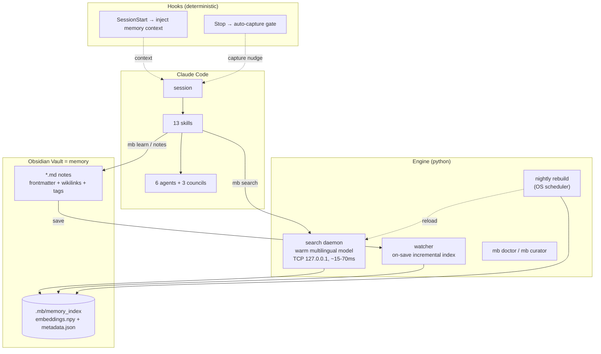

# 🧠 Singularity

**A personal AI memory system for Claude Code** — your assistant remembers everything, finds it in milliseconds, and gets smarter with every mistake.

Singularity turns an [Obsidian](https://obsidian.md) vault into a living, self-maintaining memory for your AI assistant: knowledge is **captured automatically**, **indexed on save**, **retrieved semantically** (Russian & English, ~15–70 ms), and **fed back into every new session** — while a set of disciplined skills, agents, and multi-agent councils keep the assistant's reasoning honest.

> Engine codename: **Singularity** · CLI: **`mb`** (memory brain) · Platforms: **Windows / macOS / Linux**

---

## Why?

Every AI coding session starts from zero. Decisions get re-litigated, solved bugs get re-debugged, and hard-won insights evaporate when the context window closes. Singularity closes that loop:

| Problem | Singularity's answer |
|---|---|
| "We already solved this last month…" | **Semantic search** over your whole vault: `mb search "how did we fix the reload bug"` → answer in ~20 ms |
| Insights die at the end of a session | **Auto-capture**: a Stop-hook blocks session end *once* and asks the assistant to persist what it learned |
| New session knows nothing | **Session recall**: a SessionStart-hook injects date, active tasks, pending plans, and health warnings into every session |
| The assistant repeats the same mistake | **Self-learning pipeline**: `report` → preventive rule embedded *at the exact execution point* → `LEARNED` |
| Notes rot, links break, knowledge silos | **Memory curator**: finds broken links, orphan notes, and *suggests* semantic wikilinks (never writes without approval) |
| Big decisions made on vibes | **Multi-agent councils**: adversarial investigator/critic/validator/historian rounds with falsification and calibrated confidence |

Everything lives in **plain Markdown inside your Obsidian vault** — no proprietary database, no cloud. You read and edit the same notes the assistant does; Obsidian's graph, backlinks, and Dataview dashboards work out of the box.

---

## Architecture at a glance



**Key design decisions** (reverse-engineered and battle-tested from a production system, then rebuilt cross-platform):

- **No vector database.** `sentence-transformers` + brute-force cosine over a `numpy` array. Up to ~1M chunks this is milliseconds — and infinitely debuggable.
- **Warm-model daemon.** The embedding model loads once (~10 s) and stays in RAM; every query after that is ~15–70 ms over local TCP. If the daemon dies, the client auto-restarts it — or falls back to a cold one-off search instead of failing.
- **Chunk = one `##` section.** Each chunk is embedded as `"{title} - {section}: {content}"`, so headers carry meaning. Wikilinks, tags, and aliases go into chunk metadata for filtered and graph-aware search.
- **Multilingual model** (`paraphrase-multilingual-MiniLM-L12-v2`): query in Russian, find notes written in English — and vice versa.
- **Token economy first.** Compact pipe-delimited output, 150-char excerpts, metadata trimming: a search result costs ~80 % fewer tokens than reading files, on every one of dozens of lookups per session.
- **Rules become hooks.** Critical discipline is enforced by deterministic code (hooks), not by hoping the model remembers an instruction.
- **Python core + thin platform layer.** All OS-specific code (Task Scheduler / launchd / systemd, process spawning, keyring) is isolated in `singularity/platform/`.

---

## Installation

### Prerequisites

- **Python ≥ 3.10** ([python.org](https://python.org), `winget install Python.Python.3.12`, `brew install python`, or your distro's package)
- **Git**
- **Obsidian** (recommended, not required — the engine works on any folder of Markdown)
- ~1.5 GB disk for the venv + model cache (CPU-only torch; no GPU needed)

### One command

```powershell
# Windows (PowerShell)
git clone <repo-url> D:\Singularity
cd D:\Singularity
.\install\install.ps1
```

```sh
# macOS / Linux
git clone <repo-url> ~/singularity
cd ~/singularity
./install/install.sh
```

The wrappers are ~20 lines each; all logic lives in `install/install.py`, which walks five phases:

1. **Python env** — creates `.venv`, installs dependencies, warms up the embedding model (~470 MB, cached locally — configurable off the system drive).
2. **Vault** — asks for your vault path, creates the memory folder tree (`learnings/`, `decisions/`, `howto/`, `incidents/`, `rules/`, `reference/`, `changelog/`, `templates/`, `_moc/`), binds it via `~/.singularity.json`.
3. **First index + daemon** — builds the semantic index over your vault, starts the warm daemon, runs an EN+RU smoke search.
4. **Claude Code wiring** — registers the two hooks in `~/.claude/settings.json` (careful merge: your existing settings are backed up and preserved; every entry we own is marked `"_mb": true` for clean uninstall).
5. **Scheduler + verify** — registers the nightly index rebuild and the on-save watcher with your OS scheduler (Task Scheduler / launchd / systemd — all with missed-run catch-up), then finishes with `mb doctor`.

Re-running the installer is safe — it refreshes and re-verifies instead of breaking things. To remove everything (hooks, scheduled jobs, daemon) **without touching your vault**: `mb uninstall`.

### Verify

```
mb doctor
```

You want a summary like `PASS 12`. Anything broken gets a status (`FAIL`/`WARN`/`AUTH`/`SKIP`), a reason, and a fix hint; `mb doctor --fix` repairs the light stuff, `--fix --heavy` reinstalls deps and rebuilds indexes.

---

## Usage

### 1. Search your memory (the command you'll use constantly)

```bash
mb search "how does the auto-capture hook decide to block"
mb search "почему выбрали TCP вместо unix socket"      # RU works too
mb search "reload bug" --top 10                        # more results
mb search "..." --type decision                        # learning|decision|howto|incident|rule|reference
mb search "..." --tags search,daemon                   # frontmatter + inline #tags
mb search "..." --links "Doctor_Plan"                  # only notes linked to [[Doctor_Plan]]
mb search "..." --path-prefix rules/                   # scope to a folder
mb search "..." --json --full                          # machine-readable / untruncated
```

Output is compact by design: `file | score | [type] | title/section | excerpt`. Scores ≥ 0.5 are strong matches; below ~0.3 rephrase the query.

### 2. Capture knowledge

```bash
mb learn "Watcher needs venv python on PATH — Task Scheduler runs with a minimal env" --task MY-TASK
mb note new decision "Switch to TCP transport"     # creates a note from templates/
```

Worth recording: the non-obvious, the surprising, anything that took more than one attempt, and decisions (with **owner + source** — a decision nobody owns isn't a decision). Not worth recording: anything git already shows. Code goes in as `file:line`, never pasted.

**Mostly you won't do this by hand.** The assistant does it: skills auto-append phase notes to the active task's learnings doc, and the Stop-hook nudges once per substantial session if nothing was captured.

### 3. Everything indexes itself

Save a note in Obsidian → the watcher re-indexes just that file and hot-reloads the daemon (~5–15 s) → it's searchable. A nightly full rebuild (with missed-run catch-up when the machine was off) is the safety net. Manual controls if you ever need them:

```bash
mb daemon start|stop|status|reload
mb index rebuild            # full
mb index update             # incremental (mtime+size diff)
mb watch                    # run the watcher in the foreground
```

### 4. Skills — say the trigger word in any Claude Code session

| Skill | Say… | What happens |
|---|---|---|
| `mb-search` | *sem, найди в памяти, what do we know about X* | Semantic search before any grep/file-reading |
| `mb-memory` | *um, запомни в vault* | Structured capture following the note contract |
| `workflow-helper` | *fw, wh, next* | Guides you through the solo dev workflow, one phase at a time |
| `grill` | *grill me, прожарь* | Adversarial self-interrogation before a plan/design: hidden assumptions, scope gaps — self-resolves from code+memory first |
| `confidence-calibration` | *conf, how sure are you* | Confidence computed from an evidence budget (Σ=100 %), never eyeballed |
| `memory-curator` | *curator, проверь память* | Vault health: broken links, orphans, semantic link suggestions (approval required) |
| `compaction-plan` | *cp, сохрани состояние* | Snapshots session state to the vault before a context clear; next session offers to resume |
| `report` / `error-reports` | *ты ошибся / process reports* | Mistake → PENDING note → preventive rule embedded where it will actually fire → `LEARNED` |
| `council` | *council, X vs Y, trade-off* | Architectural decision by adversarial multi-agent rounds |
| `planning-council` | *plc, разбей задачу* | Decomposition + Klein pre-mortem + three-point estimation |
| `observation-council` | *oc, why is X happening* | Hypothesis-driven root cause hunt: every hypothesis must survive a falsification attempt |

### 5. Agents — spawned for heavy lifting

Six specialists share one canonical rulebook (`rules/AGENT_SHARED_PREAMBLE.md` in the vault — lazy-loaded by section):

- **investigator** — 8-phase deep research, root-cause ×3, gap analysis
- **critic** — devil's advocate: risk taxonomy, "Argument → How to Disprove" tables, never auto-approves
- **validator** — fact-checker: claims verified against code and vault, 2+ independent sources
- **reviewer** — three-pass code review (correctness → patterns → edge cases) with severity grading
- **historian** — "have we done this before?": prior art from vault + git history, stale-flags on findings
- **coder** — executes a fully-specified plan, verifies its own edits (`git diff --stat`), refuses to freelance

Councils orchestrate them in parallel rounds with a machine-parseable contract (`HAVE SOMETHING TO ADD / NOTHING TO ADD / NEED DATA:`), anti-sycophancy rules (agreement without a new argument counts as nothing), and calibrated confidence thresholds before any verdict.

### 6. The solo workflow (optional but recommended)

Say **`fw`** at the start of a task. The workflow lives in your vault (`workflow/`), loads one phase at a time, and every phase ends with an automatic learnings append:

```
Step-Back → Approach → Investigation → Grill → Planning
→ Implementation → Review (3 passes) → Verify (actually run it!)
→ Commit → Docs + Self-learn
```

Small tasks legally skip phases (marked, not silent). The final phase asks one question — *"finalize learnings?"* — and turns any mistakes made along the way into rules.

### 7. Obsidian side

- Install the **Dataview** plugin → `_moc/Dashboard.md` shows live lists of active tasks, recent decisions, and incidents; `_moc/Orphans.md` shows unlinked notes.
- The graph view and backlinks are fed by the wikilinks the assistant writes.
- `.mb/` (indexes, daemon state, config) is excluded from Obsidian's own indexing.
- Templates for every note type live in `templates/` — usable via Templater or `mb note new`.

### 8. Local LLM backend (`mb llm`)

One command brings up a local `llama-server` (OpenAI-compatible) plus an optional router that translates Anthropic's wire format ↔ OpenAI, so a locally-hosted GGUF model can back Claude Code — or any OpenAI-compatible client — instead of a hosted API.

```bash
mb llm start <model>                  # stop any running server, spawn server, health-poll,
                                       # spawn router if configured, health-poll
mb llm stop                           # stop router, then server
mb llm status [--json]                # running model, pids, ports, liveness, started-at
mb llm list                           # models from config registry, active one marked (active)
mb llm logs [server|router] [-n N]    # tail a log (default: server, N=40)
```

`mb llm start` always stops any currently-running server first — one GPU, one model at a time. Once healthy it prints exactly one line, depending on whether a router is configured:

```
export ANTHROPIC_BASE_URL=http://<router-host>:<router-port>   # router configured
OpenAI-compatible endpoint: http://<host>:<port>/v1              # no router
```

Run that `export ANTHROPIC_BASE_URL=...` in the shell where you launch Claude Code — that's the step that actually points it at your local model.

**Two-process model.** `llama-server` speaks the OpenAI API; Claude Code speaks Anthropic's wire format, so a router sits between them and translates. The router is config-swappable — the example below runs [claude-code-router](https://github.com/musistudio/claude-code-router) (`ccr`, Node); LiteLLM (`pip`, no Node) is a drop-in alternative, just change `router.cmd`. Skip `router` entirely for a server-only setup — `mb llm start` then hands you the raw OpenAI endpoint instead. Either way, `mb` doesn't install or download anything for you: you provide `server_bin`, the `.gguf`, and (if used) the router yourself.

Config lives in `<vault>/.mb/config.json` under an `"llm"` key:

```jsonc
{
  "llm": {
    "server_bin": "C:/llama.cpp/llama-server.exe",
    "server_host": "127.0.0.1",       // default
    "server_port": 8080,               // default
    "server_ready_path": "/health",    // default
    "health_timeout_s": 120,           // default; deadline for server AND router health-poll
    "router": {                        // optional — omit for a server-only / raw OpenAI setup
      "cmd": ["ccr", "start"],         // or e.g. ["litellm", "--config", "litellm.yaml"]
      "host": "127.0.0.1",
      "port": 3456,
      "ready_path": "/health"
    },
    "models": {
      "qwen3-30b": {
        "gguf": "C:/models/qwen3-30b-a3b-q4.gguf",
        "args": ["-ngl", "99", "-c", "16384", "--jinja"]
      }
    }
  }
}
```

`--jinja` (or `--chat-template ...`) in a model's `args` is required for tool-calling; `mb llm start` prints a non-fatal warning if neither is present.

**Cross-machine:** only the paths inside `llm` change (`server_bin`, each model's `gguf`, maybe ports) — the commands above are identical on every machine, since all runtime state (`llm.state.json`, `llm-server.log`, `llm-router.log`) lives under the vault's `.mb/`.

---

## Configuration

Everything lives in `<vault>/.mb/config.json` (created with defaults on first run):

```jsonc
{
  "model": "sentence-transformers/paraphrase-multilingual-MiniLM-L12-v2",
  "min_score": 0.30,        // search cutoff
  "daemon_port": 0,          // 0 = auto-pick; actual port written to .mb/daemon.port
  "excerpt_chars": 150,
  "auto_capture": true,      // Stop-hook capture gate on/off
  "hf_cache": "...",         // model cache location (keep off the system drive)
  "code_repos_dir": null,    // optional: index your code repos too
  "connectors": {}           // optional external integrations (off by default)
}
```

Vault resolution order: `--vault` flag → `MB_HOME` env → `~/.singularity.json` pointer → default.

---

## Project layout

```
singularity/
├── cli.py                 # `mb` — the single entry point
├── config.py              # vault discovery + config
├── watch.py               # on-save incremental indexing (watchdog)
├── doctor.py              # install verification (PASS/WARN/FAIL/FIXED/SKIP/AUTH)
├── curator.py             # vault health + semantic link suggestions
├── hooks/
│   ├── session_start.py   # inject memory context into every session
│   └── stop_capture.py    # auto-capture gate (blocks stop once, BOM-proof)
├── search/
│   ├── chunking.py        # md → ## section chunks (+wikilinks/tags/aliases meta)
│   ├── indexer.py         # full rebuild + incremental (mtime+size diff)
│   ├── encoder.py         # sentence-transformers, normalized embeddings
│   ├── engine.py          # cosine search, filters, trim_meta, compact format
│   ├── daemon.py          # warm TCP daemon, ndjson protocol
│   └── client.py          # auto-start, retry, cold fallback
├── platform/              # ALL OS-specific code lives here
│   ├── scheduler.py       # Task Scheduler / launchd / systemd (+missed-run catch-up)
│   ├── proc.py            # detached process spawn per OS
│   └── secrets.py         # keyring (DPAPI/Keychain/SecretService) + file fallback
install/                   # install.py + thin ps1/sh wrappers + hook registration
tests/                     # contract tests (no ML deps needed): pytest tests -q
bin/                       # `mb` shims added to PATH
```

Plus, in your **`~/.claude/`**: 13 skills (`skills/*/SKILL.md`) and 6 agents (`agents/*.md`).
And in your **vault**: `rules/` (core discipline + agent preamble), `workflow/` (router + 10 phases), `templates/`, `_moc/` dashboards.

---

## Troubleshooting

| Symptom | Do this |
|---|---|
| Anything feels broken | `mb doctor --fix` — it diagnoses structure, deps, index, daemon, scheduler, and hooks |
| Search returns nothing | `mb daemon status` → `mb index rebuild` → check `min_score` isn't too high |
| Search is slow (~10 s) | That's a cold start (daemon was down); the query still works and the daemon auto-restarts. Antivirus killing background python? Add `.venv\Scripts\pythonw.exe` to exclusions |
| New note not searchable | Is `mb watch` running? (`mb doctor` checks the at-login job). Manual: `mb index update` |
| Pip/model downloads fail (corporate TLS) | pip: trusted hosts are pre-configured in `.venv/pip.ini`; runtime downloads use `truststore` (OS certificate store) automatically |
| Broken wikilinks / messy vault | `mb curator` — validation + fix suggestions |
| Want it gone | `mb uninstall` — removes hooks, scheduler jobs, daemon; **never touches the vault** |

Logs: `<vault>/.mb/daemon.log`, `watch.log`, `mb.log`. Last doctor run: `.mb/doctor-last.json`.

---

## Roadmap

- [ ] **Code index** — semantic search over your source repos, merged with memory results (`code_repos_dir`)
- [ ] **CI matrix** — automated test runs on Windows / macOS / Linux
- [ ] **RU score calibration** — tuned `min_score` from a bilingual query→note benchmark
- [ ] **Connectors** — optional pluggable integrations (issue trackers, logs, chat), secrets via OS keyring, off by default

## Credits

Architecture reverse-engineered from **Genevra**, a production AI memory system (macOS/bash, company-internal), then redesigned cross-platform and personal. The full reverse-engineering study, design docs, task specs, and decision log live in the vault (`01_Genevra_Analysis/`, `02_New_System_Design/`, `03_Tasks/`, `04_Plans/`) — and yes, they're semantically searchable: `mb search "why no vector database"`.

---

*Singularity: your assistant's memory should outlive the context window.*
