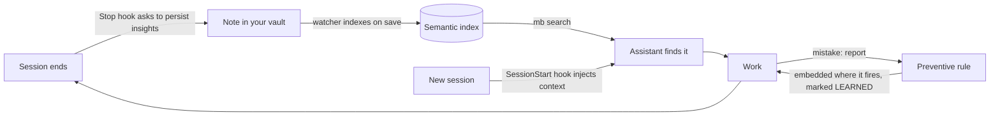

# Singularity

**Your AI assistant remembers what you decided, finds it when it matters, and stops repeating its mistakes.**


Singularity turns an [Obsidian](https://obsidian.md) vault into a persistent memory for Claude Code, Codex, Gemini CLI and Grok Build CLI. Plain Markdown on your disk, one CLI (`mb`), one shared memory for every client.

---

## The problem

- **Every session starts from zero.** The assistant does not know what you decided last week.
- **Solved bugs get re-debugged.** The fix was found once; nobody can find it now.
- **Mistakes repeat.** You correct the assistant, the context closes, the correction is gone.
- **Decisions evaporate.** The "why" behind a choice lives in a chat nobody will reopen.

## The fix

Singularity closes the loop: **capture, index, retrieve, remind, learn**. Notes are saved as Markdown, indexed on save, searched by meaning, injected into new sessions, and turned into rules when something goes wrong.



---

## What you get

| | Benefit | Try it |
|---|---|---|
| **Find, don't re-solve** | Semantic search over the whole vault. Cross-lingual: a Russian query finds an English note and vice versa. Warm-daemon latency is ~15-70 ms. | `mb search "how did we fix the reload bug"` |
| **Sessions that start informed** | A SessionStart hook injects the date, active tasks, pending plans and health warnings into every new session (Claude Code, Gemini CLI). | `mb status` |
| **Insights are not lost** | A Stop hook blocks session end once and asks the assistant to persist what it learned. Opt out any time. | `mb learn "The non-obvious fact" --task MY-TASK` |
| **It learns from mistakes** | `report` records the mistake, a preventive rule is embedded at the exact point of execution, the report is marked `LEARNED`. | say "you got it wrong" in a session |
| **A vault that stays healthy** | The curator finds broken links, orphans, near-duplicates and contradictions, and suggests links. It never writes without your approval. | `mb curator` |
| **Decisions with a second opinion** | Councils: adversarial investigator / critic / validator / historian rounds with calibrated confidence (Claude Code only). | say "council" in a session |
| **Work on a board** | `mb board` keeps tickets as notes in the vault, with enforced rules (no `done` without `review`, no unmet blockers, WIP limits) for a team-lead session that delegates to agents. | `mb board next` |

Also in the box: ingest external documents with provenance (`mb ingest`), search your source code (`--with-code`), a structural code graph (`mb code`), an optional Jev decision API (`mb jev`, off by default), and **Website Factory**, a reference-to-release pipeline for motion/3D sites with a deterministic quarantine for external components.

---

## What it looks like

```console
$ mb search "how does the auto-capture hook decide to block" --top 3
1. changelog/2026-07.md | 0.58 | [changelog] | Changelog 2026-07 - auto-capture: Stop hook blocks session end once if the session was substantial and nothing was captured ...
2. learnings/active/GRK-04.md | 0.46 | [learning@singularity] | register only proven events in one Singularity-owned hook file ...
...

$ mb doctor
[PASS] K1-code-index: 22494 chunk(s) from 1982 file(s), model matches the vault index
...
================ mb doctor summary ================
PASS 38 | SKIP 1 | WARN 2
  WARN B7-daemon: running but serving code older than the files on disk  fix: mb daemon restart

$ mb board next
DD-131  P1  <ticket title>
```

Output format is compact by design: `file | score | [type] | title/section | excerpt`. Scores of 0.5 and above are strong matches. Every problem `mb doctor` finds comes with a status, a reason and a fix hint.

Everyday loop: **check, search, work, capture, curate.**

---

## Quick start

Prerequisites: Python 3.10+, Git, about 1.5 GB of disk (CPU-only, no GPU needed). Obsidian is recommended, not required.

```sh
# 1. Get it (macOS / Linux)
git clone https://github.com/Kostik2702/singularity.git ~/singularity && cd ~/singularity

# 2. Install (Windows PowerShell: .\install\install.ps1)
./install/install.sh

# 3. Verify
mb doctor
```

The installer creates the environment, binds your vault, downloads the embedding model once (~470 MB), wires your installed clients, puts `mb` on `PATH` and registers the nightly index and on-save watcher. Re-running is safe. `mb uninstall` removes hooks, jobs and the daemon and leaves your vault untouched.

<details>
<summary>Client support, honestly</summary>

| Client | Memory + CLI + skills | Session-start recall | Capture nudge |
|---|---|---|---|
| Claude Code | yes | yes (injected) | yes |
| Gemini CLI | yes | yes (injected) | yes |
| Grok Build CLI | yes | static instruction, not injected | yes |
| Codex CLI | yes | no runtime hook | no |

Councils and other subagent-based skills are Claude Code only. Third-party CLIs are never installed for you; each is configured only if already present.
</details>

---

## Who it is for

- **The solo developer on long projects** who keeps re-explaining context to the assistant and wants decisions and fixes to be searchable a month later.
- **The multi-client user** who moves between Claude Code, Codex, Gemini and Grok and wants one memory under all of them.
- **The tinkerer who owns their data** and wants notes as plain Markdown, readable and editable in Obsidian, with no proprietary database.

## Why not just notes, or a RAG service?

- **Notes alone** only help if you remember to search them. Singularity injects context at session start, nudges capture at session end and turns corrections into rules.
- **A hosted RAG service** sends your knowledge elsewhere. Here the memory layer is local: Markdown files, a local embedding model, a local index (`numpy` and cosine similarity, no vector database). Your AI client may still use a hosted model.
- **Not magic:** it is a personal tool for one person's vault, not a team knowledge platform. Codex has no runtime hook yet, and some parts (`reel`, Jev, the code graph) are experimental or opt-in.

---

## Links

- [Full documentation](README.md): installation details, every command, configuration, troubleshooting
- [Changelog](CHANGELOG.md)
- [Upgrade guide](docs/UPGRADE.md) and [rollback guide](docs/ROLLBACK.md)

<!--
FOR THE OWNER - check before replacing README.md:
1. LICENSE: no LICENSE file in the repo, no license field in pyproject.toml, and README.md never names a license. No license badge or license link was added. Choose a license, add the file, then add a badge and a link.
2. docs/REFERENCE.md does not exist yet. Move the current README.md there and fix its internal anchors and relative links (docs/UPGRADE.md etc. become ./UPGRADE.md).
3. Latency "~15-70 ms" is quoted from README.md. On this machine just now `mb search` reported ~780 ms and `mb status` p50 518 ms / p95 644 ms (the daemon was flagged as serving stale code). Re-measure after `mb daemon restart`, or soften the claim.
4. Version badge 0.19.0 is from pyproject.toml and the top of CHANGELOG.md, but `git tag` ends at v0.9.1. Confirm the release number.
5. The "<repo-url>" in the quick start is copied from README.md. The git remote is https://github.com/Kostik2702/singularity.git; substitute it if you want a copy-paste command.
6. `mb board` and the team-lead rubric are not described in README.md. They are verified from `mb board --help`, singularity/knowledge/board.py (transition and refusal rules) and the team-lead skill in install/skill_manifest.py. "Delegates to agents" describes the skill's intent, not a tested flow.
7. The "mb search" and "mb doctor" excerpts are real output from the owner's vault, trimmed; the board line shows a real ticket from another project (DD-131). Replace with sanitized output if you do not want to show them.
8. Not mentioned on purpose because README.md is inconsistent about the counts (30 skills / 13 portable / 12 discovered; 6 vs 8 agents). The "Jev" mention rests on docs/jev.md only.
-->
