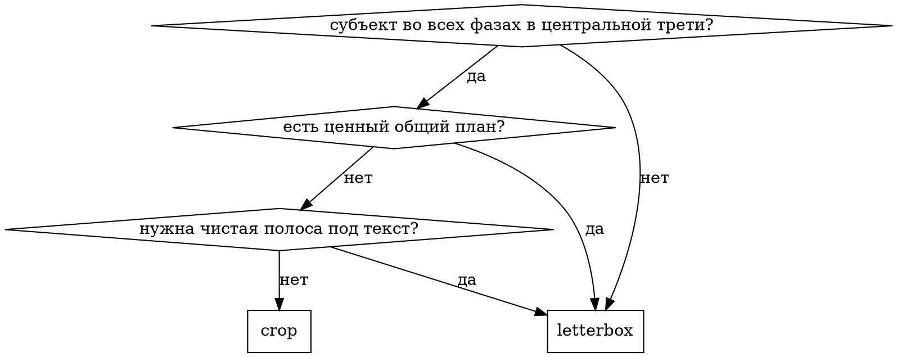

# reel-editor

> ⚠️ **ФИЧА В РАЗРАБОТКЕ (experimental, v0.9.0).** `reel` вливается в master
> незавершённым и по решению владельца помечен как experimental: контракт
> подкоманд ещё меняется, обратная совместимость не обещана, в `mb doctor` у
> него своего чека нет. Пользоваться можно, полагаться в автоматизации — рано.

> **Статус (2026-08-01): легаси-по-плану, замена заблокирована.** Скил и движок `reel`
> спроектировано заменить на `autoreels` CLI + engine-owned skill — это **AR-31** (единственная
> публичная граница автоматизации) и **AR-32** (один `singularity/skills/auto-reels/SKILL.md`
> для Claude и Codex). Обе задачи `status: BLOCKED`, бинарь `autoreels` не установлен. При этом
> сам `reel` расширяли 2026-07-31 (`light`, `sfx`) — сегодня он живой движок.
>
> Практический вывод: **не удалять до AR-32**, но и не развивать — новую функциональность
> класть в движок, а не в скил. Стеком `bridge-*` он **не** заменяется: `reel` рендерит
> **готовый файл**, CapCut Bridge собирает **редактируемый draft** и рендерить не умеет вообще.
>
> Что действительно пересекается — метод: сетка долей, кроп против леттербокса, кривая темпа.
> Эта часть теперь продублирована в `bridge-rhythm` и `bridge-framing` под другой бэкенд.
> Уникальны и не перенесены: кастинг-лист со стадиями сюжета (`references/casting.md`),
> каденция вспышек и фотосенситивность (WCAG 2.3.1), синтез щелчка затвора, приведение цвета
> между по-разному грейженными клипами, безопасность ffmpeg-графа по памяти.
>
> **Выбор:** нужен файл → сюда; нужен проект, который откроется в CapCut и его можно доснять
> руками → `bridge-montage`.

Cutting is a chain of gates, not a render command. The deterministic half is the
`reel` CLI; this skill is the judgment half, and its only real job is to stop you
shipping a cut that is technically perfect and narratively broken.

**Zero new code.** Reading metadata, slicing sheets, finding the beat, matching
colour, laying text, checking flashes — all of it is a `reel` subcommand. If
something is missing, that is an engine change, not another script in a project
folder.

**Consult the vault before deciding anything.** `mb search` for the task. The
method and its numbers live there, not in this file:
`Монтаж пачки i2v-клипов в один ролик`, `Промо-текст поверх вертикального ролика`,
`Short-form монтаж _ MOC`, `Ритм и изменение темпа`, `Вспышки и фотосенситивность`,
`Эмоциональная непрерывность сцены`, `Актёрские переходы и события сцены`.

## Quick reference

| Step | Command | Gate it opens |
|---|---|---|
| 1 приёмка | `reel probe <папка>` | дубли по MD5, разброс громкости, единый fps |
| 2 просмотр | `reel sheets <папка> --out <ev>` | что снято и что негодно |
| 3 **кастинг** | `reel cast new <папка> --out cast.json` | **кто допущен и где он в СЮЖЕТЕ** |
| 4 музыка | `reel beats` · `reel sections` | сетка и секция трека |
| 5 цвет | `reel match --mode luma` | приведение экспозиции |
| 6 шрифт | `reel fonts measure --line …` | кегль при фиксированной ширине |
| 7 EDL | `reel validate <edl> --cast cast.json` | границы, перекрытия, **причинность** |
| 8 сборка | `reel build` · `reel bed` · `reel text` | мастер |
| 8а свет и SFX | `reel light` · `reel sfx` | вспышки в пределах WCAG, щелчки НА тех же кадрах |
| 9 приёмка | `reel cuts` · `reel qa` | стыки, вспышки, громкость |

## The failure this skill exists to prevent

A cut where every measurable thing is right and the story is broken:

> земля трескается → рука пробивает землю → **снова целая трещина**

On the beat. Axis holds. Colour matches. Flashes pass. And the world un-happens.
No measurement catches it, because no measurement knows what the shots MEAN.

**The fix is structural, not vigilance.** Step 3 produces a casting sheet where
every clip gets a `verdict` and a `stage` — its position in the story, not on the
timeline. `reel validate --cast` then refuses:

- a shot taken from a `reject`ed clip (and says why it was rejected);
- a shot from a clip nobody has judged (`verdict: "?"`);
- any shot whose `stage` is lower than a stage already reached, unless it is
  explicitly `reprise: true`.

Fill the sheet **while reading the contact sheets**, in one pass, before a single
in-point is chosen. Filling it afterwards means inventing justifications for cuts
you already made.

## When crop, when letterbox

Спрашивать владельца **с цифрами** `reel build` (`scale`, `kept_width_pct`), не
словами «полный экран или с полями». Леттербокс часто **уменьшает** картинку
(1280→1080), а кроп тянет узкую полосу (405→1080) — то есть леттербокс резче,
вопреки интуиции.

## Common mistakes

| Ошибка | Что происходит | Как правильно |
|---|---|---|
| EDL до просмотра плотных листов | артефакты генерации копятся к КОНЦУ клипа и попадают в кадр | сначала `sheets`, потом `cast`, потом in-точки |
| `--mode rgb` на разных сценах | холодное кладбище становится сепией, у чёрно-красной вставки лезет бирюза | `--mode luma` + один общий `--look` |
| один статичный кроп на длинный план | субъект уходит из кадра к концу | разбить план на два со своим кадрированием |
| тайминги раскадровки как факт | документ размечен под воображаемую аранжировку | сетка из `reel sections`, раскадровка — только порядок |
| зелёный вердикт от своей же проверки | снисходительный детектор врёт | сначала убедиться, что проверка ловит заведомый дефект |

## Безопасность рендера

Тридцатисекундный ролик однажды съел ~100 ГБ и увёл машину в своп — четыре причины
подряд, ни одна не «монтаж тяжёлый». Лимит памяти на дочерний процесс включён по
умолчанию (`REEL_MEM_LIMIT_GB`, 8 ГБ); он убивает граф, а не машину.

Если рендер убит сторожем — **упрощать граф, а не поднимать лимит.** Буферизуют:
сцепленный `xfade`, `fps=` после `zoompan`. Детали и полный разбор —
`references/method.md` и [[Error - ffmpeg-граф съел 100 ГБ и повесил машину, четыре причины подряд]].

Растворения выключены: сцепленный `xfade` для них непригоден. Склейки жёсткие.

## Движение без потери резкости

На апскейле (исходник уже 416 px в ширину) выбор между `zoom` и `punch` решает
не вкус, а код: **`zoom` отключает шарпинг** (`sharpen=… and not shot.zoom`), а
`punch` — нет. Поэтому наезды ставятся только там, где движение важнее резкости,
а рядовая динамика идёт через `punch` (план приходит увеличенным на 1.10–1.20 и
оседает за 5–8 кадров). Побочная польза: punch увеличивает разницу крупности на
стыке, то есть работает и страховкой от jump cut.

`ca` (двухкадровый RGB-сдвиг) — клубный приём. В editorial-регистре он читается
как глитч, а не как удар.

## Вспышки фотокамеры и щелчки

`reel light` прогоняет готовый мастер через `LightRig`; `reel sfx` подмешивает
щелчки в бед. Два правила, оба структурные:

- **Каденция — гейт, а не предупреждение.** `verify_cadence()` отказывает
  конфигурации, которая перешла бы 3 вспышки/с, и рендер не стартует. Порог
  медицинский (WCAG 2.3.1), торговаться с ним нельзя. При 105.5 BPM доля даёт
  1.76/с, такт 0.44/с — обе в пределах.
- **Времена берутся ОДИН раз.** `reel light --report` пишет список сработавших
  ударов, `reel sfx --from-light` его читает. Пересчёт каденции на звуковой
  стороне — то, из-за чего щелчок уезжает с кадра вспышки и событие начинает
  читаться как два.

Амплитуда: на пике держать так, чтобы субъект ещё читался. Замерено: 0.85 гонит
кадр в сплошной белый и картинка теряется целиком, 0.70 даёт хлопок с сохранённым
изображением. Последний план оставлять БЕЗ вспышек — акт IV гасит долевой пульс
именно поэтому.

Щелчок затвора синтезируется, файл не нужен. В нём ДВА транзиента (зеркало, через
~45 мс шторка) — одиночный блип читается как звук интерфейса. Огибающая кладётся
`aeval`, а не `volume=…:eval=frame`: `volume` пересчитывается раз на аудиоблок
(~21 мс при 48 кГц), и семимиллисекундный транзиент на 45 мс просто не попадает
в выборку.

## Red flags — стоп, не собирать

- в `cast.json` остался хоть один `verdict: "?"`;
- `stage` не проставлен, потому что «тут и так очевидно»;
- «перекрытие в источнике невелико, сойдёт» — один момент сыграет дважды;
- «репризу помечу потом» — `reprise` ставится в момент решения, не после;
- «звук нормализован, чего его проверять» — `loudnorm` промахивается на длинных треках;
- «вспышки же слабые» — порог 3/с медицинский, а не вкусовой.

## Gates

- [ ] `schema` = `reel/1`; exit 2 = инструмент не отработал, НЕ «материал плохой».
- [ ] `reel cast show` — ни одного `?`.
- [ ] `reel validate --cast` без проблем.
- [ ] Формат подтверждён владельцем по цифрам.
- [ ] `reel cuts` просмотрен: нет jump cut, нет перескока через ось, сюжет не откатывается.
- [ ] `reel qa`: вспышек ≤3/с, 48 кГц, LUFS в допуске, true peak ≤ −1 dBFS.
- [ ] Финальный просмотр целиком на телефоне — человеческий гейт, числами не заменяется.
- [ ] Новое неочевидное — в vault (`mb learn`).

## Detail

`references/method.md` — порядок с цифрами и обоснованиями.
`references/registers.md` — готовые регистры текста, света и грейда.
`references/casting.md` — как заполнять кастинг-лист и размечать сюжетные стадии.
